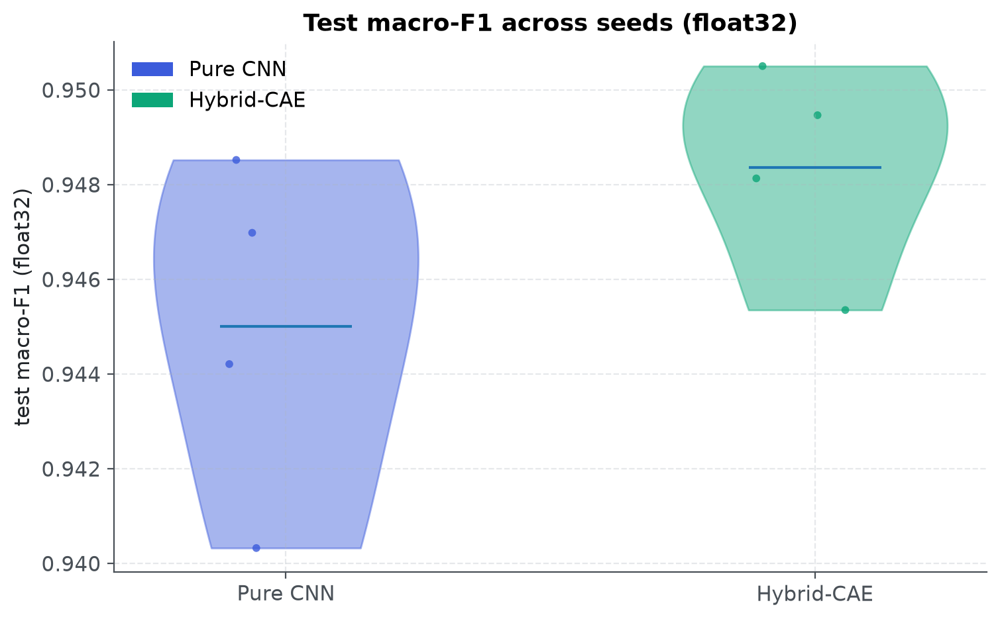
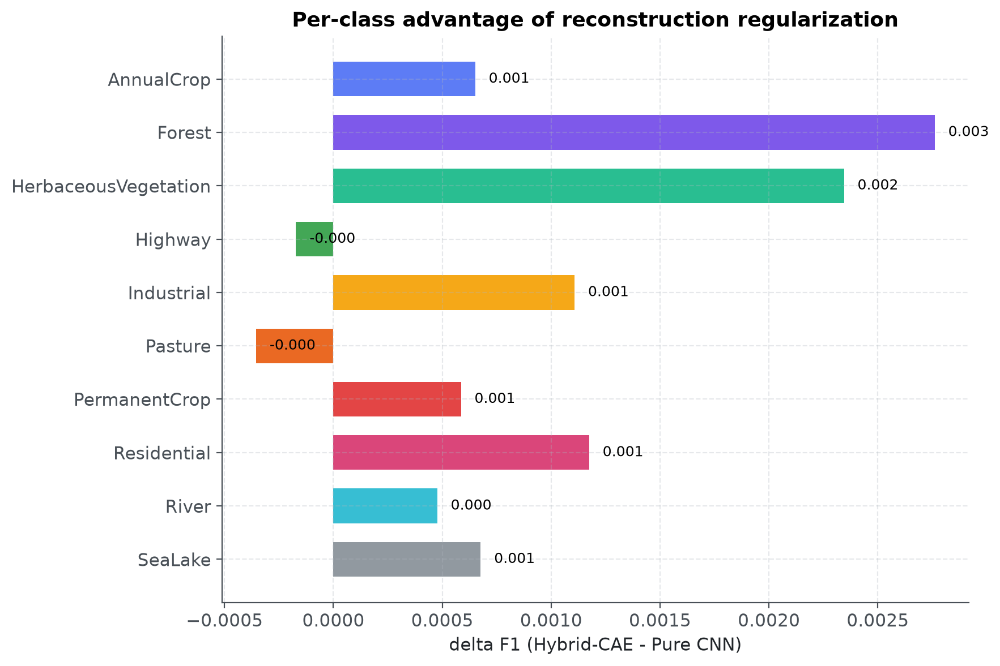
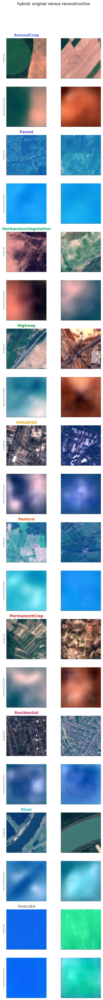
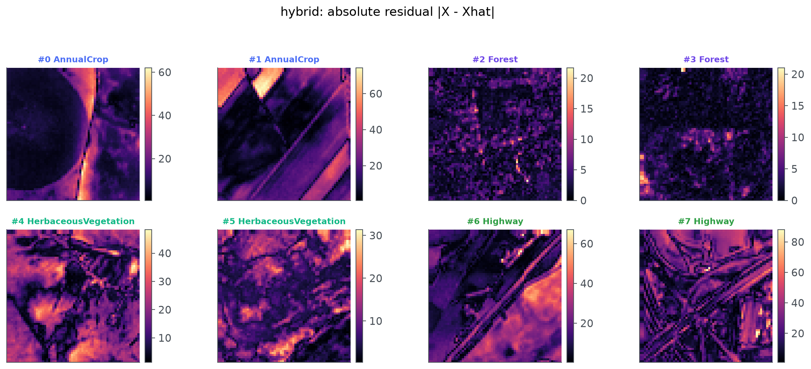
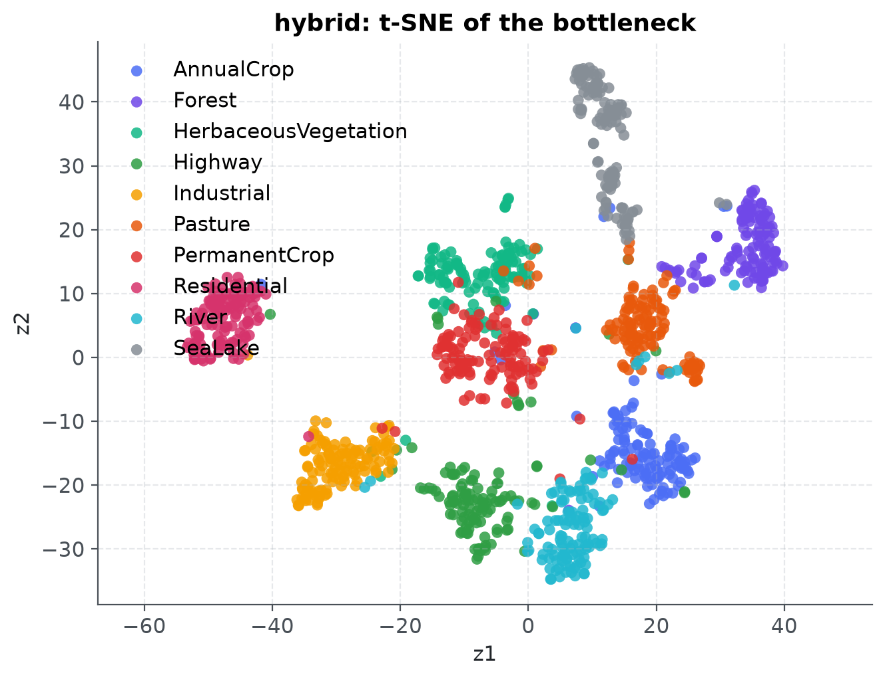
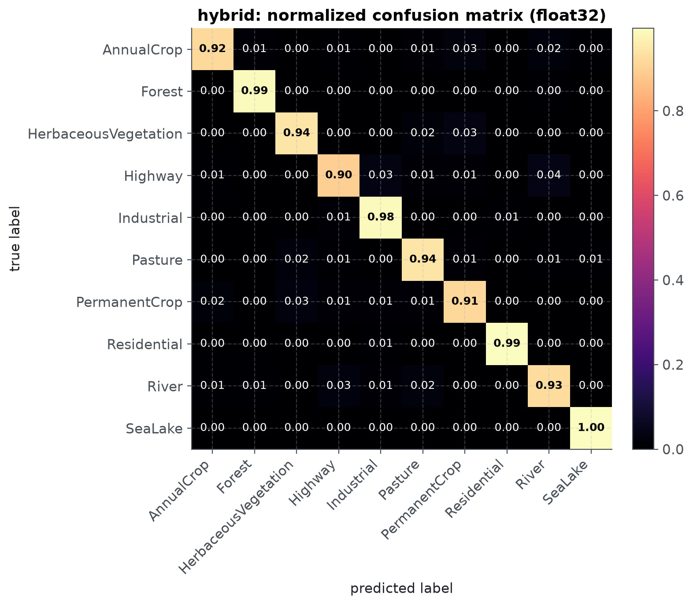

# EOS Autoencoder Engine

**Hybrid CNN-autoencoder for Sentinel-2 land-cover classification: spatial-spectral reconstruction regularization, multi-seed ablation evidence, ASVD compression, and RKHS latent-drift telemetry.**

<div align="center">


</div>

---

## Overview

This repository implements a **multi-task Hybrid Convolutional Autoencoder
(Hybrid-CAE)** for 64 × 64 EuroSAT Sentinel-2 patches. One shared encoder
produces a 128-dimensional bottleneck consumed by two heads:

- a **10-class land-use / land-cover classifier** trained with cross-entropy;
- a **symmetric decoder** trained to reconstruct the input, regularizing the
  latent space with a composite MSE + SSIM objective.

The research question is simple: *does adding the reconstruction objective improve
classification over a pure CNN at identical architecture, data, budget, and seed?*
At 12 seeds per arm the answer is **no detectable difference** — the measured
advantage is inside the noise. What the hybrid does buy is a working decoder and a
latent space alongside the classifier (see [Results](#results)).

Post-training, dense layers are compressed with **Adaptive SVD (ASVD)** rank
truncation, and the latent distribution is monitored with a **Reproducing Kernel
Hilbert Space Maximum Mean Discrepancy (MMD)** test against a calibrated
validation baseline.

```
                          ┌────────────────────────────────────────┐
                          │     Shared Convolutional Encoder       │
                          │   64×64×3 ──► Strided Convs ──► z ∈ R¹²⁸│
                          └───────────────────┬────────────────────┘
                                              │
                     ┌────────────────────────┴────────────────────────┐
                     ▼                                                 ▼
    ┌─────────────────────────────────┐               ┌─────────────────────────────────┐
    │      Classification Head        │               │       Reconstruction Head       │
    │ z ──► Linear ──► 10 LULC Logits │               │ z ──► Deconvs ──► 64×64×3 Patch │
    │     Loss: Cross-Entropy         │               │       Loss: MSE + SSIM          │
    └─────────────────────────────────┘               └─────────────────────────────────┘
```

---

## Status

| Component | State |
|---|---|
| Environment, quality gates, service stack, ROCm runtime | **Complete** |
| EuroSAT data pipeline (fetch → extract → validate → split → curate → verify) | **Complete** |
| Curated dataset `eurosat-rgb-v1.0.0` (27,000 patches; 18,900 / 4,050 / 4,050) | **Complete** |
| Encoder, decoder, classification head, SSIM and multi-task losses | **Complete** |
| SSIM boundary-policy benchmark (F-001) | **Complete** — `reports/ssim-boundary/` |
| Multi-task training, three ablation arms, MLflow + Prometheus telemetry | **Complete** — 26 full-budget runs (12 seeds per arm) |
| Evidence bundle + multi-seed / per-class analysis (F-002, F-003) | **Complete** — `reports/ablation/evidence/` |
| Self-bootstrapping experiment notebook | **Complete** — `notebooks/01_hybrid_autoencoder.ipynb` |
| ASVD compression (M4 met at energy 0.90) and MMD drift telemetry | **Complete** — `reports/compression/`, `reports/telemetry/` |

---

## Repository Structure and Data Flow

```
space-encoder/
├── configs/                  base experiment config + CPU fast-dev-run overrides
├── data/
│   ├── contracts/            immutable dataset expectations
│   ├── manifests/            committed validation and verification evidence
│   ├── raw/                  pinned archive + extracted tree   (gitignored)
│   └── processed/            curated arrays and split indices  (gitignored)
├── docker/                   ROCm runtime, compose stack, Prometheus, Grafana
├── notebooks/
│   └── 01_hybrid_autoencoder.ipynb   deliverable notebook
├── references/               links-only: upstream projects + curated reading
│   ├── README.md
│   └── ROCm/README.md
├── reports/
│   ├── ablation/
│   │   ├── ablation.json     tracked three-arm budget and metric record
│   │   └── evidence/         committed evidence bundle (JSON + NPZ, 1.7 MB)
│   ├── figures/notebook/     19 rendered figures (transparent backgrounds)
│   └── ssim-boundary/        F-001 benchmark evidence and figures
├── scripts/                  data fetch, gates, health checks, ROCm verification
├── src/eos/
│   ├── config.py             Pydantic configuration contracts
│   ├── contracts.py          comment, docstring, and config validators
│   ├── evaluation.py         checkpoint reload + offline re-evaluation core
│   ├── dataset/              ingestion, validation, splits, curation, DataModule
│   ├── experiments/          bounded studies (SSIM boundary policy)
│   ├── model/                encoder, decoder, heads, composite losses, ASVD
│   ├── telemetry/            MMD drift monitoring and metric export
│   ├── training/             LightningModule, runner, MLflow, job metrics
│   └── utils/                logging, visualization, seeding
└── tests/                    unit + integration suites (311 tests)
```

### Data Flow

```
┌──────────────────┐    ┌────────────────────┐    ┌─────────────────────────┐
│ EuroSAT archive  │ ─► │ eos-data pipeline  │ ─► │ data/processed/         │
│ (pinned SHA-256) │    │ validate · dedup   │    │ eurosat-rgb-v1.0.0      │
└──────────────────┘    │ split · curate     │    │ memmap + splits + stats │
                        └────────────────────┘    └───────────┬─────────────┘
                                                              │
┌─────────────────────────────────────────────────────────────▼─────────────┐
│ TRAINING (ROCm container, bf16-mixed)                                      │
│ eos-train {hybrid | classifier | autoencoder} × seeds {42, 7, 123, 2024}   │
│ MLflow: params, per-epoch metrics, best checkpoint, metrics.json           │
│ Prometheus: fit wall-time, GPU util → Grafana dashboards                   │
└──────────────────────────────┬────────────────────────────────────────────┘
                               │
┌──────────────────────────────▼────────────────────────────────────────────┐
│ EVALUATION & EVIDENCE (float32, no retraining)                             │
│ scripts/build_evidence.py → reports/ablation/evidence/                     │
│ run_metrics.json (per-class F1, confusion, histories) + embeddings/recon   │
│ notebooks/01_hybrid_autoencoder.ipynb renders the evidence                 │
└────────────────────────────────────────────────────────────────────────────┘
```

---

## Codebase Flow

### Stage 1 — Data engineering (`src/eos/dataset/`, `scripts/fetch_eurosat.py`)

| Module | Role |
|---|---|
| `ingest.py` / `cli.py` | Download with retries, ranged resume, pinned SHA-256 check |
| `validate.py` | Decode every image; exact and perceptual duplicate detection; quarantine |
| `splits.py` | Deterministic, group-aware, stratified 70/15/15 assignment (seed 42) |
| `curate.py` / `storage.py` | Image memmap, labels, split indices, channel statistics |
| `manifest.py` | Content-addressed manifest with fingerprint `f7ccc0bc…f9754570` |
| `eurosat_datamodule.py` | `LightningDataModule` with augmentation-free test transforms |

### Stage 2 — Models and objectives (`src/eos/model/`)

| Module | Role |
|---|---|
| `encoder.py` / `decoder.py` | Exact `64 → 32 → 16 → 8 → 4` strided convs; symmetric `ConvTranspose2d` decoder |
| `classifier.py` | Hidden projection + 10-class logits head |
| `hybrid_cae.py` | `HybridCAE`, `PureCNN`, `ConvAE` — identical components, different objectives |
| `losses.py` | Composite `α·MSE + (1−α)(1−SSIM)` with masked/valid boundary policies (F-001) |
| `experiments/ssim_boundary.py` | Bounded study: what the SSIM boundary policy actually penalizes |

### Stage 3 — Training (`src/eos/training/`)

| Module | Role |
|---|---|
| `lightning_module.py` | One `LightningModule` for all three arms; scheduled λ(t) reconstruction weight |
| `runner.py` | Trainer construction, callbacks, budget normalization, resume |
| `mlflow_logger.py` | Parameter flattening, per-epoch metrics, artifact logging |
| `job_metrics.py` | Prometheus job wall/GPU times pushed via Pushgateway |
| `cli.py` | `eos-train` with `hybrid`, `classifier`, `autoencoder`, `ablation` |

### Stage 4 — Evaluation and evidence (`src/eos/evaluation.py`, `scripts/build_evidence.py`)

| Component | Role |
|---|---|
| `load_module_from_checkpoint` | Rebuilds a module from the provenance inside every checkpoint — no config drift |
| `evaluate_classification` / `evaluate_reconstruction` | Macro-F1, per-class F1, confusion; MSE + SSIM masked + SSIM valid |
| `collect_embeddings` / `collect_recon_samples` | Deterministic, class-balanced latent and image sampling |
| `scripts/build_evidence.py` | MLflow discovery → checkpoint cache → full re-evaluation → committed bundle |

### Stage 5 — Deliverable notebook (`notebooks/01_hybrid_autoencoder.ipynb`)

Self-bootstrapping (Colab clone + install), CPU `fast-dev-run` profile,
load-and-re-evaluate narrative path, ablation table, multi-seed distributions,
per-class slice, confusion matrices, patch grids across all 10 classes, residual
heatmaps, PCA/t-SNE/3D latent projections, loss trajectories, and the findings
cell. It never retrains models to produce results.

---

## Core Competency

### Optimization

| Technique | Module |
|---|---|
| **Composite MSE + SSIM objective** | Structural term regularizes the bottleneck; masked-window policy (F-001) |
| **Scheduled multi-task balancing** | λ(t) annealed `0.3 → 0.1` inside the `[0.1, 0.5]` band |
| **Mixed precision discipline** | `bf16-mixed` on GPU, `32-true` on CPU; SSIM always float32 with autocast disabled |
| **ASVD rank truncation** | Adaptive SVD of dense layers with an energy target and a compression-gain guard |
| **Deterministic evidence** | Float32 re-evaluation of stored checkpoints; per-precision metrics labelled (F-002) |

### MLOps & Services

| Tool | Purpose |
|---|---|
| **MLflow** | Run tracking, best-checkpoint artifacts, metrics JSON lineage |
| **Prometheus + Pushgateway** | Job fit/wall-time and GPU telemetry |
| **Grafana** | EOS Training / Latent Drift / Compression dashboards |
| **Docker (ROCm)** | WSL2 DXCore GPU paravirtualization, pinned `rocm/pytorch` image |
| **GitHub Actions** | Single blocking quality-gate job, path-scoped tooling |
| **DVC** | Content-addressed dataset stages (`dvc.yaml` mirrors the CLI graph) |

### Algorithms

| Algorithm | Application |
|---|---|
| **Shared-encoder multi-task CNN** | Classification + reconstruction on one 128-d bottleneck |
| **SSIM (masked / valid policies)** | Structural similarity with explicit boundary semantics |
| **Per-class F1 analysis** | Mechanism-sensitive endpoint (cropland complex, F-003) |
| **t-SNE / PCA manifold projections** | Latent geometry comparison across arms |
| **MMD two-sample test** | RKHS drift detection on L2-normalized embeddings, bootstrapped alarm threshold |

### Software Engineering

| Practice | Implementation |
|---|---|
| **Strict typing** | `mypy --strict` over `src/` and `scripts/` |
| **Contract gate** | Pydantic configs, zero `#` comments, Google docstrings — AST-enforced |
| **Test discipline** | 311 tests, 85% coverage floor (current: 90.7%), TDD for model and loss work |
| **Scoped tooling** | ruff/mypy restricted to `src scripts tests notebooks` at every layer |
| **Deterministic packaging** | `uv` with lockfile; reproducible evidence bundle from committed scripts |

---

## Getting Started

### Prerequisites

- Python 3.12 (`uv python install 3.12`)
- Docker + Docker Compose (services and the ROCm training container)
- Optional: AMD GPU under WSL2 for full-budget training

### Installation

```bash
git clone https://github.com/ayman-codes/space-encoder.git
cd space-encoder
uv python install 3.12
uv sync --all-groups --extra notebook
```

### Dataset

```bash
uv run eos-data all        # full local pipeline
uv run eos-data status     # manifest state and fingerprint
uv run eos-data verify     # manifest, split, and array invariants
```

Published dataset: 27,000 RGB patches (64 × 64, 10 classes) — train 18,900 ·
validation 4,050 · test 4,050, exact per-class allocation, perceptual-duplicate
groups isolated within one split. Radiometric contract: inputs scaled to
`[0, 1]`, decoder terminated with `Sigmoid`; ImageNet mean/std normalization is
never applied.

### Services

| Service | URL | Image |
|---|---|---|
| MLflow | http://localhost:5001 | `ghcr.io/mlflow/mlflow:v3.12.0` |
| Prometheus | http://localhost:9092 | `prom/prometheus:v3.9.1` |
| Pushgateway | http://localhost:9091 | `prom/pushgateway:v1` |
| Grafana | http://localhost:3001 | `grafana/grafana:12.4.13` |
| JupyterLab | http://localhost:8888 | local `eos-rocm:10.1.0` (`--profile gpu`) |

```powershell
powershell -ExecutionPolicy Bypass -File scripts/start_services.ps1
uv run python scripts/health_check.py
```

### Tests

```bash
uv run pytest --cov                                   # full suite
uv run pytest -q -m "not gpu and not slow and not integration"   # fast subset
```

---

## Quality Gates

Four blocking gates run locally and in CI. Nothing merges without all four.

| Gate | Tool | Enforces |
|---|---|---|
| Contracts | `scripts/validate_contracts.py` | Pydantic configs, zero `#` comments, Google docstrings everywhere |
| Lint & format | `ruff format --check`, `ruff check` | `E,F,W,I,N,UP,B,ANN,D,ERA,SIM,PL,PT,RUF,PTH` at line length 100 |
| Types | `mypy --strict` | Zero untyped definitions across `src/` and `scripts/` |
| Tests | `pytest --cov` | Unit + integration suites, 85% coverage floor |

```bash
uv run ruff format --check src scripts tests notebooks
uv run ruff check src scripts tests notebooks
uv run mypy
uv run python scripts/validate_contracts.py
uv run pytest --cov
```

Current baseline: **311 tests passing, 90.7% coverage**, `mypy --strict` clean.
Ruff and mypy are scoped to this repository's code at every layer — CI, the
gate script, `pyproject.toml`, and pre-commit all exclude dependency caches,
`references/`, and generated artifacts.

`scripts/gate.ps1` is the blocking authority; `scripts/precommit.ps1 --all-files`
is the fast staged-file subset.

---

## Training

`eos-train` exposes the three ablation arms, an aggregate ablation command, and
a resumable multi-seed campaign. All arms share one `LightningModule`, one
optimizer schedule, one metric contract, one stopping rule, and one budget; only
the objective differs.

```bash
uv run eos-train hybrid --fast-dev-run
uv run eos-train classifier --config configs/base.yaml
uv run eos-train hybrid --max-epochs 1
uv run eos-train hybrid --resume checkpoints/hybrid-seed42/last.ckpt
uv run eos-train ablation
uv run eos-train campaign --seeds 42 7 123 2024
uv run eos-train campaign --assemble-only
```

| Arm | Model | Objective | Checkpoint monitor |
|---|---|---|---|
| `hybrid` | `HybridCAE` | `CE + λ(t)·(α·MSE + (1−α)(1−SSIM))` | `val/macro_f1_smooth` (max) |
| `classifier` | `PureCNN` | `CE` | `val/macro_f1_smooth` (max) |
| `autoencoder` | `ConvAE` | `α·MSE + (1−α)(1−SSIM)` | `val/recon_mse_smooth` (min) |

Full-budget contract (the convergence regime of `configs/base.yaml`): AdamW
(lr 1e-3, weight decay 1e-4), 2-epoch linear warmup into `ReduceLROnPlateau`
(factor 0.5, patience 5, floor 1e-6), gradient clipping 1.0, batch 128, and a
100-epoch ceiling that `EarlyStopping` (patience 12, `min_delta` 0.001 on
macro-F1 / 1e-5 on reconstruction MSE) ends early once the monitored metric
stops moving. The monitored metric is a 3-epoch trailing mean, because the raw
validation curve wobbles by ~0.03–0.14 macro-F1 between adjacent epochs and
would otherwise fire the stopping rule on training noise. λ(t) anneals 0.3 →
0.1 across the declared ceiling, so a run that stops early keeps more
reconstruction pressure than the old fixed 30-epoch schedule. Each arm records
the epochs it actually consumed.

**Every run is resumable.** Each (arm, seed) job owns an isolated workspace —
`checkpoints/<arm>-seed<seed>/` (checkpoints, `last.ckpt`, tracking run id) and
`reports/training/<arm>/seed<seed>/metrics.json` — so seeds never overwrite each
other and an interrupted job has exactly one continuation point. Re-running
`eos-train campaign` with the same grid skips completed jobs, resumes
interrupted ones from `last.ckpt` into the same MLflow run (one continuous
per-epoch metric history), and trains only what is missing; `--force` retrains
from scratch, `--assemble-only` writes the evidence documents without training.
Outputs: `reports/ablation/campaign.json` (job ledger with budget parity and
epochs consumed), `reports/ablation/ablation.json` (three-arm record for the
seed of record).

Inside the ROCm container the tracking URI is the compose service name
(`MLFLOW_TRACKING_URI=http://mlflow:5000`); `localhost:5001` is the host-side
URL.

---

## Evaluation & Evidence Bundle

Training is never repeated to produce results. `scripts/build_evidence.py`
discovers the full-budget runs in MLflow, caches their best checkpoints, and
re-evaluates all of them on the 4,050-patch test split in float32:

```bash
docker compose -f docker/docker-compose.yml --env-file .env --profile gpu \
  run --rm --no-deps eos-gpu uv run --no-sync python scripts/build_evidence.py
```

| Artifact | Contents |
|---|---|
| `reports/ablation/evidence/run_metrics.json` | Per-run provenance, macro-F1, per-class F1, confusion, MSE/SSIM pair, per-epoch histories |
| `embeddings_{classifier,hybrid}.npz` | 1,200 × 128 float32 bottlenecks, class-balanced |
| `recon_samples_{autoencoder,hybrid}.npz` | Original/reconstructed uint8 patches across all 10 classes |

Total bundle size: 1.7 MB, tracked, deterministic, and idempotent to rebuild.

---

## Results

**The hypothesis is not confirmed.** At 12 seeds per arm the hybrid and the pure
CNN are statistically indistinguishable on test macro-F1: mean paired advantage
+0.0009, 6/12 seeds positive, one-sided p = 0.21. The +0.0034 advantage visible in
the first four seeds averaged −0.0003 across the eight newer ones. What survives is
a clean negative: reconstruction regularization does not hurt classification at
equal budget, and it hands you a working decoder and latent space alongside the
classifier.

| Model | Parameters | Test macro-F1 (float32) | Test micro-F1 |
|---|---|---|---|
| Pure CNN | 2,609,546 | 0.9464 ± 0.0028 (n=12) | 0.9488 |
| Hybrid-CAE | 6,453,421 | 0.9474 ± 0.0024 (n=12) | 0.9498 |
| ASVD Hybrid-CAE | 5,629,229 (−39% dense) | 0.9497 (single checkpoint) | 0.9523 |

Five findings survived the work; the full discussion is in
[`notebooks/01_hybrid_autoencoder.ipynb`](notebooks/01_hybrid_autoencoder.ipynb).

| Finding | What it says |
|---|---|
| **F-001** SSIM boundary policy | The boundary policy, not the window size, decides what the loss penalizes at patch edges; the masked policy is the only one at area parity and is the training default |
| **F-002** Evaluation precision | Identical weights differ by up to 0.0048 macro-F1 between bf16-mixed logging and float32 re-evaluation; every number here is labelled float32 |
| **F-003** Mechanism | The 4-seed cropland trend (texture discrimination over boundary topology) weakened at 12 seeds; a hint, not a finding |
| **F-004** ASVD compression | 39% of dense weights removed for +0.0002 macro-F1 at energy 0.90, milestone bar met, skipped layers recorded; no latency speedup claimed |
| **F-005** MMD drift telemetry | Unbiased RKHS two-sample test with a bootstrapped threshold detects radiometric shifts and class-mix changes, and refuses baselines bound to another model state |

<p align="center">
  
  
</p>
<p align="center">
  
  
</p>
<p align="center">
  
  
</p>
<p align="center">
  seed distributions · per-class deltas · reconstructions · residual maps · latent space · confusion
</p>

---

## GPU Runtime (WSL2 + ROCm)

Training target: **AMD Radeon RX 9070 XT** (RDNA 4, `gfx1201`, 16 GB) through
WSL2 DXCore paravirtualization.

```bash
docker compose -f docker/docker-compose.yml --env-file .env --profile gpu build eos-gpu
docker compose -f docker/docker-compose.yml --env-file .env --profile gpu run --rm --no-deps \
  eos-gpu uv run --no-sync python scripts/verify_rocm.py
```

Pinned image: `rocm/pytorch:rocm10.1.0_ubuntu24.04_py3.12_pytorch_release_2.14.0`.

Wiring that is easy to get wrong:

- every entry point enforces a 12 GiB per-process VRAM budget through
  `eos.device.cap_vram`, so the desktop session keeps the rest of the card;
- mount only `/dev/dxg`; never `/dev/kfd` or `/dev/dri` in WSL2;
- bind `/usr/lib/wsl/lib:/usr/lib/wsl/lib:ro` and put it on `LD_LIBRARY_PATH`,
  otherwise `libdxcore.so` is not found and `torch.cuda.is_available()` is `False`;
- `ipc: host` and `shm_size: "16gb"` to keep DataLoader workers from deadlocking;
- `HSA_OVERRIDE_GFX_VERSION` stays unset — `gfx1201` is native on ROCm 10.1.0;
- mixed precision resolves at runtime: `bf16-mixed` on GPU, `32-true` on CPU;
  FP16 is never used because unscaled SSIM variance denominators underflow.

---

## CI/CD Pipeline

One blocking job on `push` and `pull_request` to `main`/`master`, running in
`ghcr.io/astral-sh/uv:python3.12-bookworm-slim`:

```
sync → ruff format → ruff lint → contract gate → mypy strict → pytest --cov
```

| Step | Command | Notes |
|---|---|---|
| Sync | `uv sync --frozen --all-groups` | Lockfile-pinned |
| Ruff format | `uv run ruff format --check src scripts tests notebooks` | Path-scoped by design |
| Ruff lint | `uv run ruff check src scripts tests notebooks` | Same scope |
| Contract gate | `uv run python scripts/validate_contracts.py` | Zero-`#`, docstrings, config contracts |
| Mypy | `uv run mypy` | `files = ["src", "scripts"]` |
| Pytest | `uv run pytest --cov` | 85% coverage floor |

## Monitoring Architecture

```
Training / evaluation runs
      │
      ▼
Job metrics (job_metrics.py) ──► Pushgateway ──► Prometheus ──► Grafana
      │
      ▼
MLflow: parameters, per-epoch metrics, checkpoints, metrics.json
```

Grafana ships three provisioned dashboards — **EOS Training**, **EOS Latent
Drift**, **EOS Compression** — querying `eos_recon_mse`, `eos_val_macro_f1`,
`eos_mmd_score`, `eos_mmd_alarm`, `eos_asvd_param_ratio`, `eos_asvd_f1_delta`.
The drift and compression series come from `scripts/calibrate_mmd.py` and
`scripts/run_asvd_benchmark.py`.

---

## Development Workflow

```powershell
git config --local core.hooksPath .githooks   # one line per fresh clone
powershell -ExecutionPolicy Bypass -File scripts/precommit.ps1 --all-files
```

`.githooks/pre-commit` sets `PRE_COMMIT_HOME=.cache/pre-commit` and delegates to
the pinned `pre-commit` in `.venv`. Conventions worth knowing before a PR:

- **No `#` comments** in Python or notebook code cells. Document with Google
  docstrings; only shebangs, `# type: ignore[...]`, and `# noqa: CODE` are allowed.
- **Configs are contracts.** Unknown keys fail at load time; adding a field means
  updating `src/eos/config.py`, `configs/*.yaml`, and the contract tests.
- **`references/` is links-only.** Upstream projects are cited by URL
  ([`references/README.md`](references/README.md)); code adapted into `src/`
  names its provenance in the module docstring.
- **Tool scope is enforced everywhere.** ruff/mypy inspect `src scripts tests
  notebooks` only; any new tool cache must be gitignored and excluded in
  `pyproject.toml`, `.pre-commit-config.yaml`, and CI in the same commit.
- **The published tree is curated.** `.vscode/`, the local roadmap, and
  vendored dumps are never committed.

---

## Roadmap

| Phase | Scope | State |
|---|---|---|
| 2 | Encoder, decoder, heads, MSE + SSIM losses | **Done** — exact `64 → 4 → 64` symmetry, SSIM float32 guard |
| 3 | LightningModule, three ablation arms, MLflow | **Done** — 26 full-budget runs, 12 seeds per arm, metrics of record |
| 4 | ASVD compression, MMD calibration and drift monitoring | **Done** — M4 met at energy 0.90; drift demo + telemetry live |
| 5 | Self-bootstrapping notebook + evidence bundle | **Done** — notebook renders committed evidence |
| 6 | Convergence-driven retraining: longer budget, plateau LR, early stopping | **In progress** — regime and resumable campaign shipped, campaign runs pending |

ASVD stays a bounded experiment: the hidden classifier projection is only ~8.3k
parameters, so compression is reported over the dense parameter set and over the
whole model separately.

---

## Troubleshooting Mini-Guide

| Symptom | Cause | Fix |
|---|---|---|
| `torch.cuda.is_available()` is `False` in the container | `libdxcore.so` not on the loader path | mount `/usr/lib/wsl/lib` read-only, export `LD_LIBRARY_PATH=/usr/lib/wsl/lib` |
| DataLoader hangs with workers | shared memory exhausted | `ipc: host`, `shm_size: "16gb"`, or `num_workers=0` |
| CI `ruff` reformats thousands of cache files | tool discovered dependency caches | scope commands to `src scripts tests notebooks`; cache dirs must be gitignored + in `extend-exclude` |
| MLflow artifact upload fails with `WinError 5` | container-local artifact root advertised | `--serve-artifacts` + `--artifacts-destination`, experiment with `mlflow-artifacts:/` |
| `PermissionError: [WinError 5]` from pre-commit | hook store defaults outside the repo | `PRE_COMMIT_HOME=.cache/pre-commit`, hooks via `.githooks` |
| Manifest fingerprint mismatch | manifest rebuilt with different contract or seed | rerun `eos-data split` after confirming the contract |
| Coverage gate fails | new module without tests | add unit tests; the floor is 85% |

---

## References

Curated links — related project, similar implementations, and local notes —
live in [`references/README.md`](references/README.md). Design lineage for
ASVD and MMD telemetry:
[Wafer Defect Detection with Ensemble Meta-Learning](https://github.com/ayman-codes/Wafer-Defect-detection-with-Ensemble-meta-learning).

- Helber, P., Bischke, B., Dengel, A., Borth, D. (2019). *EuroSAT: A Novel
  Dataset and Deep Learning Benchmark for Land Use and Land Cover
  Classification.* IEEE JSTARS.
- Wang, Z., Bovik, A. C., Sheikh, H. R., Simoncelli, E. P. (2004). *Image
  Quality Assessment: From Error Visibility to Structural Similarity.* IEEE TIP.
- Gretton, A., Borgwardt, K. M., Rasch, M. J., Schölkopf, B., Smola, A. (2012).
  *A Kernel Two-Sample Test.* JMLR.

## License

MIT. The EuroSAT dataset is distributed under the terms of its Zenodo record;
see the dataset card for the authoritative statement.
